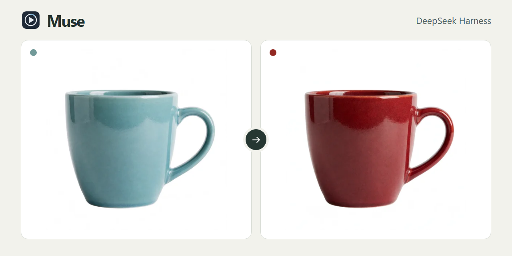
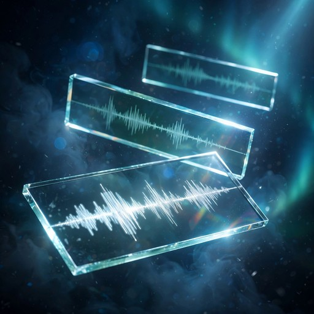
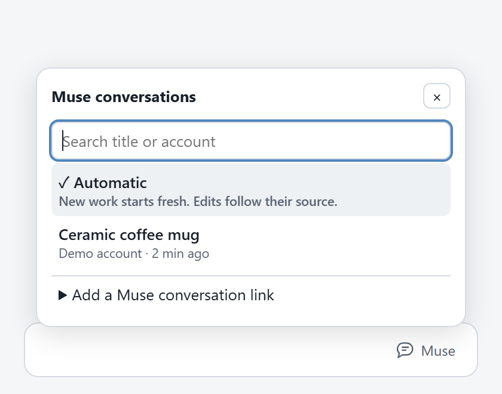
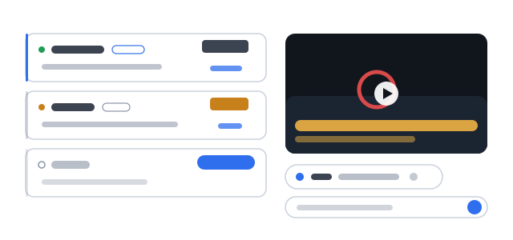

# Muse Media for DeepSeek Harness

[](https://www.npmjs.com/package/dsh-muse-media)
[](https://www.npmjs.com/package/dsh-muse-media)
[](./LICENSE)
[](#install-and-sign-in)

Generate images and videos in a DSH conversation with your own Muse account. Ask for a change to revise the last result, or open its saved file directly from History.

[中文](README.md) · [Install and sign in](#install-and-sign-in) · [Release notes](https://github.com/sizhe03/dsh-muse-media/releases/latest) · [Report an issue](https://github.com/sizhe03/dsh-muse-media/issues/new/choose)

**Using the plugin in mainland China? Try Muse on the web before installing.** Open [muse.ai](https://muse.ai/) on the same computer, sign in, and try the feature you need. Test video separately: an account that can chat or generate images may still receive a region restriction for video.

- **Blank sign-in window?** Open the same address in your usual Chrome or Edge browser. If both are blank, check whether your network can reach Muse. If the site works there and only the plugin window stays blank, follow the plugin troubleshooting steps.
- **Muse says the feature is unavailable in your region?** Use it in a region where Muse offers it, with an eligible account. If only video is restricted, you can still use image generation if it works on the web. For video, wait for access or use a service available locally. [Troubleshooting and observed results](docs/TROUBLESHOOTING.md#english) · [Muse Help Centre](https://www.meta.com/en-gb/help/superintelligence/1303670544995562/)



> “Change the glaze to deep red and keep everything else the same.” These are the two previews saved during that revision.

## Video example · Seamless looping avatar

**From the maintainer.** Two free Muse accounts with generation access have covered my frequent image and video work. I ran the same image prompts through ChatGPT, Google and Muse across several rounds and usually kept the Muse result. In some sessions my Google Pro allowance ran out after a few rounds, while a batch of Muse images barely moved my weekly usage. I saw no visible watermark on the files I kept. The avatar below took one video generation; for clips that need another pass, I keep the original and ask for specific edits. You can check your own allowance in Settings.

<a href="https://github.com/sizhe03/dsh-muse-media/blob/main/docs/examples/crystal-waveform-avatar.mp4"></a>

The finished avatar is a looping MP4 video. Make it in two turns in DSH:

1. **First turn · Generate an image.** Ask DSH to “use Muse to generate a still image for the first frame,” then paste the image prompt. Choose the still you want to animate. [Original image prompt (Chinese)](docs/examples/crystal-waveform-avatar-image-prompt-zh.txt) · [Selected 1600 × 1600 still](docs/examples/crystal-waveform-avatar-first-frame.webp)
2. **Second turn · Generate a video.** Attach the selected still to your next DSH message. Ask DSH to “use Muse to generate a looping video starting from this image,” then paste the video prompt. The camera and crystals stay still while a silver-blue pulse traces the waveforms from back to front. This video took one generation. [Original video prompt (Chinese)](docs/examples/crystal-waveform-avatar-video-prompt-zh.txt)

[Watch the original MP4 (4 s · 1080 × 1080 · 24 fps · silent)](https://github.com/sizhe03/dsh-muse-media/blob/main/docs/examples/crystal-waveform-avatar.mp4) · [English prompt submitted for the video task](docs/examples/crystal-waveform-avatar-prompt.txt)

## Install and sign in

1. Search for **Muse media** in the DSH plugin market and install it.
2. Go to **Settings → Muse**, select **Add account**, then **Open sign-in window** on the account row. Sign in to Muse in that browser window.
3. Return to Settings and wait for the account to show **Ready**. If the status hasn’t updated, select **Verify sign-in**.

Once installed, ask in the conversation: “Use Muse to draw a teal ceramic mug on a white background.” To try video, attach the mug image and ask “Use Muse to make a four-second video starting from this frame, with the camera moving slowly toward the rim.” Each generation uses the selected Muse account’s allowance and runs through your installed Chrome, Chromium or Edge.

See the [manifest](package.json) for compatible DSH and Node versions. Market installs receive updates through DSH. For local development, the package is also available on [npm](https://www.npmjs.com/package/dsh-muse-media):

```bash
npm install dsh-muse-media
```

### Can’t find Muse in the market? Copy the index URL

Add this URL to the DSH plugin market’s index list, refresh it, then search for **Muse media** again.

```text
https://raw.githubusercontent.com/sizhe03/dsh-muse-media/main/market-index.json
```

## Continue an image or video

After drawing the mug, ask “Change the glaze to deep red and keep the shape and lighting.” **Automatic** opens a fresh Muse conversation for new work and returns to the original account and conversation for edits.

To revisit an older project, select **Muse** beside the DSH composer and search by title or account. Once selected, image and video requests in **this DSH chat** continue from the latest turn in that Muse conversation. Choose **Automatic** to unpin it. If it is missing from the list, expand the link option, select the original account, and paste the Muse conversation URL.



*The plugin’s conversation picker, shown with a sample account and title.*

## Find the saved file

Go to **Settings → Muse → History**, find the work, and select **Show in folder**. Windows selects that exact file in Explorer. You can also download the image or video from its record, or expand the record to see its full path.

If the record says **Preview only**, its download is the preview. Open the original Muse conversation from the record to look for the full-size download without spending another generation credit. For older records without a link, use the conversation history on Muse.

## Accounts, usage and side chats

- **Read usage.** The weekly figure beside the composer belongs to the displayed Muse account. While idle, it shows the account you are viewing. During generation, it shows the account doing the work. Hover for the reset date, or refresh the reading in Accounts.
- **Choose an account.** New work defaults to an available account whose weekly allowance resets soonest. Ask “Use acc-02 for this video” to select one explicitly. If that account becomes unavailable, the task stops. Edits and pinned chats use the original account. Usage queries accept an account name and default to the account selected in Settings.
- **Keep projects separate.** By default, after a new account’s first verified sign-in, the plugin sends a rule to the **main Muse chat** asking Muse to use only the current side chat’s context. Read the full rule in Settings. Existing accounts can request it manually. Turning off automatic setup applies to future accounts.
- **Original video first.** On first verified sign-in, new accounts also ask Muse to deliver the first video from each run and wait for instructions before reworking it. This rule has its own switch. Expand an account to set or remove the rule, or read an existing receipt from the main chat.
- **Check or remove the rule.** Expand an account to see the time and Muse’s reply to the last set or removal request. If unconfirmed, **Check chat receipt** reads the existing conversation again. Removal identifies the rule by its name, `DSH-Muse-旁聊独立-v1`, and asks Muse to avoid repeating it. The receipt records Muse’s response. Its effect on a particular generation depends on Muse.

### Usage display and common settings



**Common ones** — change these in Settings and select Save:

| Setting | Default | Purpose |
| --- | --- | --- |
| `autoSetMemoryRule` | `true` | Write the side-chat rule after a new account's first verified sign-in. Turning it off affects only accounts added later; rules already written are not removed. |
| `showQuotaInComposer` | `true` | Show weekly usage beside the composer |
| `headlessAfterLogin` | `true` | Generate in the background after sign-in |
| `idleReapSeconds` | `600` | Seconds before closing an idle browser. Use `0` to keep it open. |
| `maxLiveBrowsers` | `2` | Concurrent browsers. Use `0` for unlimited. |
| `imageTimeoutSeconds` | `300` | Seconds to wait for an image |
| `videoTimeoutSeconds` | `780` | Seconds to wait for a video |
| `autoRefreshQuotaSeconds` | `300` | Seconds between automatic usage refreshes. Use `0` to stop refreshing automatically. |

**The rest live in `cordis.patch.yml`** and rarely need changing:

| Setting | Default | Purpose |
| --- | --- | --- |
| `chromePath` | `""` | Explicit Chrome path; detected automatically when empty |
| `maxAccountsPerTask` | `2` | Accounts tried per task, including the preferred one |
| `quotaTimeoutSeconds` | `90` | Timeout for reading the usage panel |
| `deliveryWarnSeconds` | `25` | Seconds after sending before warning that delivery is unconfirmed |
| `deliveryUnknownSeconds` | `60` | Seconds after sending before the outcome is treated as unknown |
| `probeTimeoutSeconds` | `60` | Timeout for the conversation check |
| `debugPortBase` | `19220` | First debug port; the next free one is used if taken |

### Tools and verbatim prompts

| Tool | Use |
| --- | --- |
| `muse_draw_image` | Generate from text or supply up to 10 references via `image`. Local paths, `file://`, data URLs, and chat attachment IDs (`attachmentId`) are supported. |
| `muse_draw_video` | Describe duration, camera and motion. To start from a particular frame, pass it as the first reference image. |
| `muse_quota` | Read the Muse plan, weekly usage, next reset, and extra allowance. |

Both generation tools accept a complete `prompt`. To reuse a brief verbatim from the current DSH chat, supply its exact opening and closing excerpts, including punctuation, in `promptSource`. Put additional instructions in `promptAmendment`. A missing or ambiguous range stops the call before task creation.

## Help and feedback

For a small image, a refusal, a region restriction, or an unknown outcome after sending, look up the symptom in [Troubleshooting](docs/TROUBLESHOOTING.md#english). When reporting a bug, include the steps, what happened, and your plugin and DSH versions. For questions and feature ideas, use [Discussions](https://github.com/sizhe03/dsh-muse-media/discussions).

[Report an issue](https://github.com/sizhe03/dsh-muse-media/issues/new/choose) · [Security](SECURITY.md) · [Design](docs/DESIGN.md) · [Contributing](CONTRIBUTING.md#development-and-releases) · [Credits](THIRD_PARTY_NOTICES.md) · [MIT license](LICENSE)
