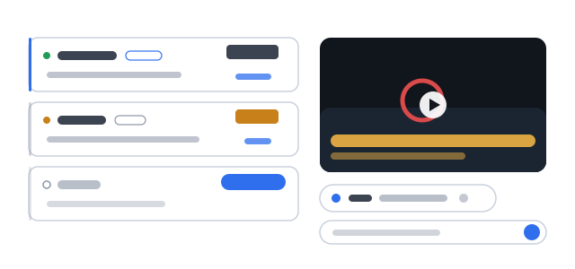

# dsh-muse-media

[](https://www.npmjs.com/package/dsh-muse-media)
[](https://www.npmjs.com/package/dsh-muse-media)
[](./LICENSE)
[](https://github.com/deepseek-ai)

用你自己的 Muse 账号在 DeepSeek Harness 对话里生成图片和视频，并在输入框旁看到本周免费额度。

> English: [README.en.md](README.en.md)

插件**自带浏览器驱动**：通过 Chrome DevTools Protocol 操作本机已安装的 Chrome/Chromium/Edge。不需要 Python，不需要 muse2api，不需要装第二个插件，也不碰你日常浏览器的配置。



## 快速开始

```bash
npm install dsh-muse-media
```

然后在 Harness 里：**设置 → Muse → 新增账号 → 打开登录窗口**，在弹出的 Chrome 里登录 muse.ai 一次。

之后在对话里直接说「用 Muse 画一张……」即可。

## 前提

三样东西，缺一不可：

1. **Chrome / Chromium / Edge**（任一基于 Chromium 的浏览器）。插件不打包浏览器。
2. **DeepSeek Harness** 0.2.2-rc.5 或同一小版本线，Node `^22.19.0 || >=24.0.0`。
3. **你自己的 Muse 个人账号**（免费账号即可）。插件只驱动你已登录的浏览器，注册和登录都由你完成。

## 用法

对话里直接用工具：

- `muse_draw_image` —— 文生图；传 `image`（本机路径、`file://`、data URL 或对话附件的 `attachmentId`）就是图生图，最多 10 张参考图。
- `muse_draw_video` —— 文生视频；传 `image` 就用那张图当起始画面。多张参考图可以一起上传，但 Muse 只保证第一张生效，其余是否被采用没有文档说明。
- `muse_quota` —— 读计划名、本周已用百分比、下次重置时间，另附独立的额外额度。

Muse 没有独立的视频模式：界面上只有一个对话框，「生成视频」靠提示词表达，所以时长和镜头要写进 `prompt`。

## 设置页

三个页签，各自回答一个问题：

- **账号** —— 现在用哪个账号、本周用了多少。点额度数字即可刷新；「新增账号」展开标签输入框。
- **记录** —— 最近生成了什么、用哪个账号、耗时和额度消耗，附本周汇总。
- **高级** —— 浏览器与超时的设置（改动立即生效，无需重启）、诊断信息、磁盘占用与媒体清理。

输入框旁的胶囊显示 `Muse · 周额度已用 25% · acc-01`，悬停看计划、重置时间、数据时间和当前账号身份。

## 账号是怎么选的

装多个账号时，插件按**周额度最早重置**的账号优先，其次才是用量和你的「同条件时优先」标记。理由是周额度到期即作废，而额外额度不会过期——先把会消失的花掉。

空闲时胶囊显示的是**你正在查看的账号**，下一次生成可能选另一个。悬停会说明这一点。

## 会消耗额度

每次生成都真实消耗该账号的 Muse 额度，和你在网页上手动点一次一样。

同一个提示词两次的结果不同——上游没有种子，插件也不提供种子控制。

上游限流或额度耗尽时本次任务停止，**不会自动换号去绕过**（只在登录失效这一种情形下才允许换号）。

## 边界

- 只驱动你自己装的浏览器，只在本机开调试端口（`127.0.0.1`）。
- 退出时只关闭**插件自己启动**的浏览器进程，不碰你的日常浏览器。
- 同时运行的浏览器数量有上限（默认 2），因为一个无头 Muse 页面约占 1 GB 内存。
- 已交付的媒体**不会自动删除**——它们是花额度换来的，且被对话里的消息引用。清理只有你点「清空已下载媒体」才会发生。
- 不提供：代理中转、签到领取、媒体库、缩略图、FFmpeg、画布、批量工作台。
- 对话只用于连通测试，不接入 Muse 的对话模型，也不适配它的工具调用。
- 这个插件只消耗 Muse 账号的额度，不影响也不调用其他已安装的生图/视频插件。

## 更新

**从 npm 安装才会收到更新。** Harness 的插件管理器会去注册表查有没有更新版本，在设置页给出更新入口，点一下即可，不需要重装。

拖本地目录（`file:` / `link:`）安装的副本不会被标记为可更新——它的代码就在你的磁盘上。想跟新版本就重新 `npm install dsh-muse-media`。

## 配置

所有可调项都在 `cordis.patch.yml`，也能在**设置 → Muse → 高级**里改（保存后立即生效）。常用几项：

| 键 | 默认 | 说明 |
|---|---|---|
| `headlessAfterLogin` | `true` | 生成时不显示窗口；只有首次登录需要可见窗口 |
| `idleReapSeconds` | `600` | 浏览器闲置多久后关闭，`0` 不关 |
| `maxLiveBrowsers` | `2` | 同时运行的浏览器上限，`0` 不限制 |
| `imageTimeoutSeconds` | `300` | 生图等待上限 |
| `videoTimeoutSeconds` | `780` | 生视频等待上限 |

## 文档

- [`docs/DESIGN.md`](docs/DESIGN.md) —— 设计与实现说明：发送边界、故障分类、选号逻辑、为什么某些限制是故意的
- [`THIRD_PARTY_NOTICES.md`](THIRD_PARTY_NOTICES.md) —— 参考来源

## 许可

MIT。见 [`LICENSE`](LICENSE)。
