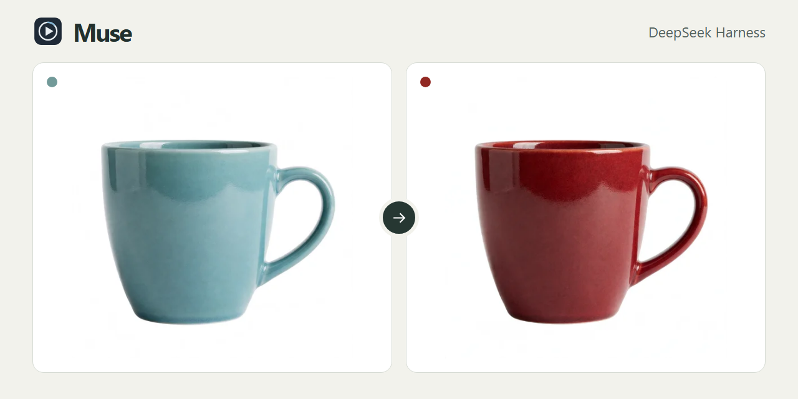
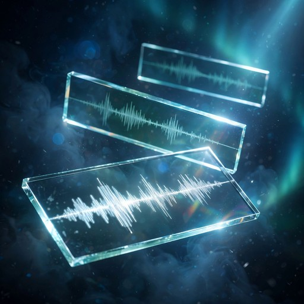
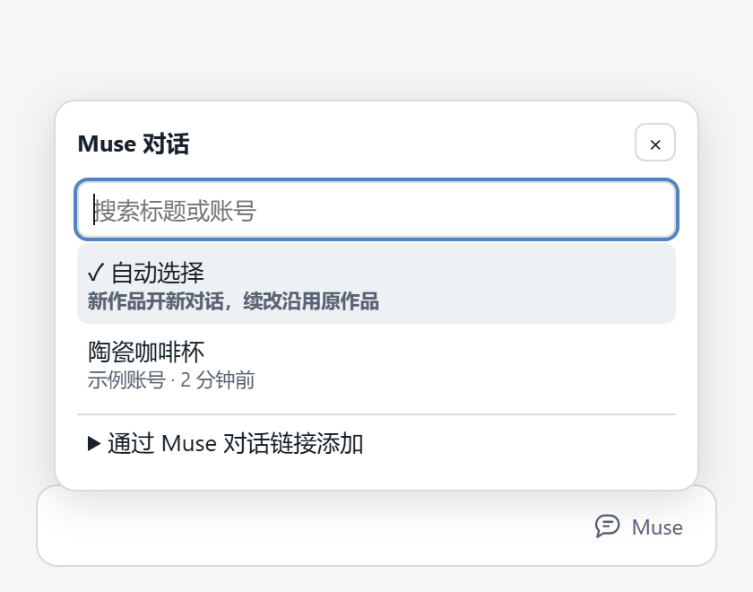

# Muse 媒体 · DeepSeek Harness

[](https://www.npmjs.com/package/dsh-muse-media)
[](https://www.npmjs.com/package/dsh-muse-media)
[](./LICENSE)
[](#安装与登录)

用自己的 Muse 账号，在 DSH 对话里生成图片和视频。想改刚才的作品，直接说要改哪里；想找原文件，去生成记录里点一下就能定位。

[English](README.en.md) · [安装与登录](#安装与登录) · [版本说明](https://github.com/sizhe03/dsh-muse-media/releases/latest) · [报告问题](https://github.com/sizhe03/dsh-muse-media/issues/new/choose)

**中国大陆用户，安装前请先试 Muse 网页。** 在准备使用插件的电脑上打开 [muse.ai](https://muse.ai/)，登录自己的账号，手动试一次你要用的功能。要做视频，请直接试视频；能聊天或出图的账号，也可能收到视频地区限制。

- **窗口打开却一直空白？** 在同一台电脑的普通 Chrome 或 Edge 里打开同一网址。两边都打不开，先检查网络能否访问 Muse；普通浏览器能用，只有插件窗口空白，再按插件故障排查。
- **Muse 明确提示地区不可用？** 该功能需要在 Muse 已开放的地区、用有相应权限的账号使用。如果当前只有视频受限，可以继续用网页实测可用的生图功能；视频等 Muse 开放，或先用当地可用的视频工具。插件沿用网页权限。[地区排查与实测记录](docs/TROUBLESHOOTING.md#中文) · [Muse 官方帮助](https://www.meta.com/en-gb/help/superintelligence/1303670544995562/)



> 「把杯子的釉色改成深红色，其他一切保持不变。」上图是这次续改前后实际保存的两张预览。

## 视频示例 · 无缝循环动态头像

**维护者的使用体验。** 我用两个可正常生成的免费 Muse 账号，已经够我频繁做图和视频。有几轮用同一条提示词分别让 ChatGPT、Google 和 Muse 出图，我最后大多选了 Muse。我的 Google Pro 额度有时几轮就见底，Muse 出完一批图，周用量只涨了一点。我保存的成品里没看到可见水印。下面这段声纹头像视频也是一次成片；需要进一步打磨的作品，可以留着原片接着改。每个账号的实际余量可在设置里查看。

<a href="https://github.com/sizhe03/dsh-muse-media/blob/main/docs/examples/crystal-waveform-avatar.mp4"></a>

这个动态头像是一段可循环播放的 MP4 视频。你可以在 DSH 里分两轮制作：

1. **第一轮 · 生图。** 在 DSH 里说「用 Muse 生成一张静态首帧图」，接着粘贴第一轮提示词。先选好构图清楚的那张图，留给下一轮当首帧。[复制生图提示词](docs/examples/crystal-waveform-avatar-image-prompt-zh.txt) · [查看本例选用的 1600 × 1600 首帧图](docs/examples/crystal-waveform-avatar-first-frame.webp)
2. **第二轮 · 生视频。** 在下一条 DSH 消息里附上选好的首帧，说「用 Muse 以这张图为首帧生成循环视频」，接着粘贴第二轮提示词。镜头和晶体保持静止，银青色的光沿声纹由远及近扫过，再回到起点。这段视频一次生成成功。[复制生视频提示词](docs/examples/crystal-waveform-avatar-video-prompt-zh.txt)

[观看 MP4 原片（4 秒 · 1080 × 1080 · 24 fps · 无声）](https://github.com/sizhe03/dsh-muse-media/blob/main/docs/examples/crystal-waveform-avatar.mp4) · [查看视频任务实际提交的英文提示词](docs/examples/crystal-waveform-avatar-prompt.txt)

## 安装与登录

1. 在 DSH 插件市场搜索 **Muse 媒体** 并安装。
2. 打开 **设置 → Muse**，点 **新增账号**，再在账号行点 **打开登录窗口**。在弹出的浏览器里登录自己的 Muse 账号。
3. 回到设置页，等账号显示 **可用**。如果状态还没更新，点 **验证登录**。

装好后直接在对话里说「用 Muse 画一只青釉咖啡杯，白色背景」。想做视频，可以附上杯子的图片，再说「用 Muse 以这张图为首帧，做一段 4 秒视频，镜头缓慢推近杯口」。每次生成使用所选 Muse 账号的额度，插件会调用本机安装的 Chrome、Chromium 或 Edge。

适用版本见 [插件清单](package.json)。通过市场安装后，可在 DSH 中接收更新。本地开发也可以通过 [npm](https://www.npmjs.com/package/dsh-muse-media) 安装：

```bash
npm install dsh-muse-media
```

### 市场里搜不到 Muse？复制这个索引地址

把下面的完整地址添加到 DSH 插件市场的索引列表，刷新后再次搜索 **Muse 媒体**。

```text
https://raw.githubusercontent.com/sizhe03/dsh-muse-media/main/market-index.json
```

## 接着改一张图或一段视频

刚画完杯子，直接说「把釉色改成深红色，保留杯形和光线」，就能在原 Muse 对话里接着改。默认的「自动选择」会为新作品开新对话，续改则沿用原作品的账号和对话。

想改几天前的作品，点 DSH 输入框旁的 **Muse**，按标题或账号搜索，再选中那条对话。此后，**当前 DSH 聊天**里的 Muse 生图和视频都会接到所选对话的最新一轮。选回「自动选择」即可解除固定。列表里找不到的作品，可以展开「通过 Muse 对话链接添加」，选择原账号并粘贴网页地址。



*插件的对话选择器，使用示例账号和标题。*

## 找到原图和原视频

打开 **设置 → Muse → 生成记录**，找到对应作品，点 **打开文件所在位置**。Windows 会在资源管理器里直接选中那一份文件。也可以在记录里下载图片或视频，展开查看完整路径。

如果记录标为 **仅预览**，下载按钮保存的是这张预览图。点 **打开 Muse 原对话** 查找上游可下载的原图，无需再次生成。缺少链接的旧记录可以从 Muse 的历史对话找回。

## 账号、额度与旁聊

- **看额度。** 输入框旁的「周额度已用」属于显示的 Muse 账号。空闲时是当前查看的账号，生成时是本次使用的账号。悬停可看重置时间，在账号页点「刷新」可读取新数据。
- **选账号。** 新作品默认优先使用周额度最早重置的可用账号。想指定账号，可以说「用 acc-02 生成这段视频」。指定账号无法完成请求时任务停止；续改或固定对话须用原账号。查额度也可以点名，省略时查询当前选中的账号。
- **减少不同作品互相干扰。** 默认在新账号首次验证登录后，插件向 **Muse 主聊天**发送一次长期规则，请 Muse 只沿用当前旁聊的内容。设置页可展开阅读规则全文。已有账号可手动设置，关闭自动设置只影响后续新账号。
- **视频原片优先。** 新账号首次验证登录时，默认另向 Muse 主聊天请求保存一条长期规则：先交付本轮第一版视频，指出偏差，等你明确要求后再返工。可单独关闭自动设置。已有账号可在账号行展开「视频原片优先」，设置、移除或读取主聊天回执。
- **核对或移除规则。** 展开账号可看设置或移除请求的时间和 Muse 实际回复。「待确认」时点「重新读取回执」会再读主聊天，无需重发。移除时只指明规则名 `DSH-Muse-旁聊独立-v1` 并请 Muse 避免复述。回执能确认 Muse 如何回应，实际生成效果仍取决于 Muse。

### 查看额度示意图和常用设置


**常用的**（设置页里就能改，改完点「保存」）：

| 设置项 | 默认值 | 用途 |
| --- | --- | --- |
| `autoSetMemoryRule` | `true` | 新账号验证登录后自动写入旁聊独立规则。关闭只影响**以后新增**的账号，已写入的规则不会被移除 |
| `showQuotaInComposer` | `true` | 在输入框旁显示周额度 |
| `headlessAfterLogin` | `true` | 登录后在后台生成，不弹窗口 |
| `idleReapSeconds` | `600` | 浏览器闲置多少秒后关闭，`0` 表示保持打开 |
| `maxLiveBrowsers` | `2` | 同时运行的浏览器数，`0` 表示不限 |
| `imageTimeoutSeconds` | `300` | 等待图片的秒数 |
| `videoTimeoutSeconds` | `780` | 等待视频的秒数 |
| `autoRefreshQuotaSeconds` | `300` | 额度每多少秒自动刷新一次，`0` 表示不自动刷 |

**其余的在 `cordis.patch.yml` 里改**（一般不需要动）：

| 设置项 | 默认值 | 用途 |
| --- | --- | --- |
| `chromePath` | `""` | 指定 Chrome 路径，留空则自动探测 |
| `maxAccountsPerTask` | `2` | 单个任务最多尝试几个账号（含首选） |
| `quotaTimeoutSeconds` | `90` | 读取额度面板的超时 |
| `deliveryWarnSeconds` | `25` | 发送后多久仍无证据就提示「尚未确认送达」 |
| `deliveryUnknownSeconds` | `60` | 发送后多久判为「结果未知」 |
| `probeTimeoutSeconds` | `60` | 对话连通测试的超时 |
| `debugPortBase` | `19220` | 调试端口起始值，冲突时自动往上找 |

### 生成工具与原文提示词

| 工具 | 用法 |
| --- | --- |
| `muse_draw_image` | 从文字生图，或通过 `image` 提供最多 10 张参考图。支持本机路径、`file://`、data URL 和对话附件的 `attachmentId`。 |
| `muse_draw_video` | 描述时长、镜头和动作。要从指定画面开始，把首帧放在第一张参考图。 |
| `muse_quota` | 读取 Muse 计划、本周已用比例、重置时间和额外额度。 |

图片和视频工具都接受完整的 `prompt`。需要逐字使用当前 DSH 聊天里的原文时，可用 `promptSource` 指定含首尾标点的起止短句，新增要求写入 `promptAmendment`。如果范围缺失或有多处匹配，插件会在创建任务前要求修正。

## 帮助与反馈

尺寸偏小、内容被拒、账号所在地区无法生成视频，或发送后结果未知时，先按现象查[排查指南](docs/TROUBLESHOOTING.md#中文)。报告故障时请附上操作步骤、实际结果，以及插件和 DSH 的版本。使用疑问和功能建议可发到 [Discussions](https://github.com/sizhe03/dsh-muse-media/discussions)。

[提交问题](https://github.com/sizhe03/dsh-muse-media/issues/new/choose) · [安全说明](SECURITY.md) · [设计说明](docs/DESIGN.md) · [参与贡献](CONTRIBUTING.md) · [第三方来源](THIRD_PARTY_NOTICES.md) · [MIT 许可](LICENSE)
